# Janitor AI Extractor

**A browser-based workspace to import, inspect, edit and export character data, with a companion-extension bridge for live extraction and prompt capture.**

## Features

- **Normal Extraction:** paste or import Character Card JSON, supported PNG character cards, HTML, text and local images.
- **Definitions:** edit common character fields, retain additional fields, restore the imported snapshot and export TXT, JSON or Character Card V2-shaped JSON.
- **Assets:** preview and download imported images, export lorebook/world-info data and create an assets ZIP where browser permissions allow.
- **Card Design:** edit supplied HTML/CSS and preview it inside a sandboxed iframe.
- **Prompt Capture workspace:** inspect captured OpenAI-compatible request bodies, view message roles and metadata, keep an in-memory session history and export requests.
- **Extension connection status:** the workspace uses a versioned message bridge to detect when the separate Brave extension is connected.

## Browser-only architecture

The web application is static and does not run a Node.js API server. The future Brave extension will operate inside the signed-in Janitor AI browser session, observe the configured custom-proxy chat request, capture the request body and return a mock OpenAI-compatible response. It will then send sanitized capture data to this workspace through the documented extension bridge.

**The extension is not included in this repository.** It will be developed and delivered separately after the web application is complete. Until it is installed, the workspace supports manual source import and manual request JSON inspection; the extension status remains Disconnected.

Captured prompts and imported character data are held in page memory only. Refreshing or closing the tab clears the current workspace. Downloads are initiated by the user. The application does not request Janitor AI passwords, session cookies or API authorization keys.

## Use the web application

Deploy the repository with GitHub Pages, then open the published site in Brave. No npm start command, local API process, database or backend hosting is required for the web application.

To preview the static site locally, serve the repository root with any static HTTP server. For example, Python's built-in static server can be used. This is only for previewing the static files; it does not run a Fake API receiver.

## Importing character data

1. Paste accessible JSON, HTML or labelled text into the source box, or select supported files.
2. Choose **Extract fields**.
3. Review the Definitions, Assets and Card Design tabs.
4. Edit fields as needed. Arrays and objects should be kept as valid JSON in their editors.
5. Export the edited definitions, Character Card JSON, original source or complete extraction session.

Supported imports include ordinary JSON, common Character Card V2-style spec/data objects, PNG chara/ccv3 metadata where supported by the browser, HTML, text, CSS and local image files. Parsing is best-effort: unknown fields are retained as additional fields when present in the character data object.

Some remote image hosts block cross-origin downloads. In that case, open the original image source and save it manually. ZIP export includes only remote assets that the browser is permitted to fetch.

## Prompt Capture workflow

1. Open **Prompt Capture** in the workspace.
2. Install and connect the separate Brave extension when it is delivered.
3. Configure Janitor AI's custom proxy settings as usual.
4. Start capture from the workspace.
5. Send a chat message in Janitor AI. The extension will capture the request and send the mock response back to Janitor AI.
6. Inspect and export the captured request here.

The extension bridge protocol is documented in docs/EXTENSION_BRIDGE.md. The exact Janitor AI request mechanism and browser permissions must be verified in the target Brave version during extension development. A website cannot reliably inspect another site's authenticated page by itself; that is why the companion extension is a separate component.

## Privacy and responsible use

- Use only characters and content you own or have permission to inspect.
- Respect creator privacy settings, platform rules and access controls.
- Do not attempt to reveal server-side data that the signed-in page or configured request does not expose.
- Prompt request bodies may contain private conversations. Keep exported files secure.
- The extension protocol intentionally excludes cookies and authorization secrets from captured data.

## Project structure

    Janitor-AI-Extractor/
    ├── index.html
    ├── README.md
    ├── LICENSE
    ├── package.json              # Test scripts only; no runtime dependencies
    ├── assets/
    │   ├── css/styles.css
    │   ├── images/banner.svg
    │   └── js/
    │       ├── app.js
    │       ├── core/extension-bridge.js
    │       ├── importers/character-importer.js
    │       └── utils/download.js
    ├── docs/
    │   ├── ARCHITECTURE.md
    │   └── EXTENSION_BRIDGE.md
    ├── tests/
    │   └── character-importer.test.mjs
    └── .github/workflows/
        ├── validate.yml
        └── pages.yml

## Development checks

Node.js is used only by the optional automated test suite. The deployed web app itself is static and requires no Node runtime.

    npm test
    npm run check

## Deployment

GitHub Actions validates the JavaScript modules and importer tests, then deploys the static site to GitHub Pages on pushes to the main branch, after Pages is enabled for the repository.

## License

MIT — see LICENSE.
